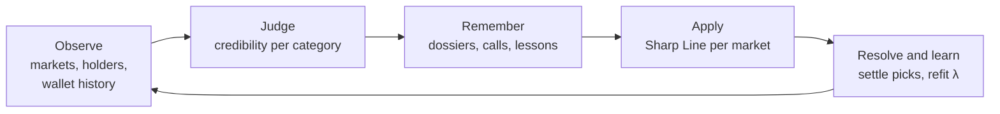
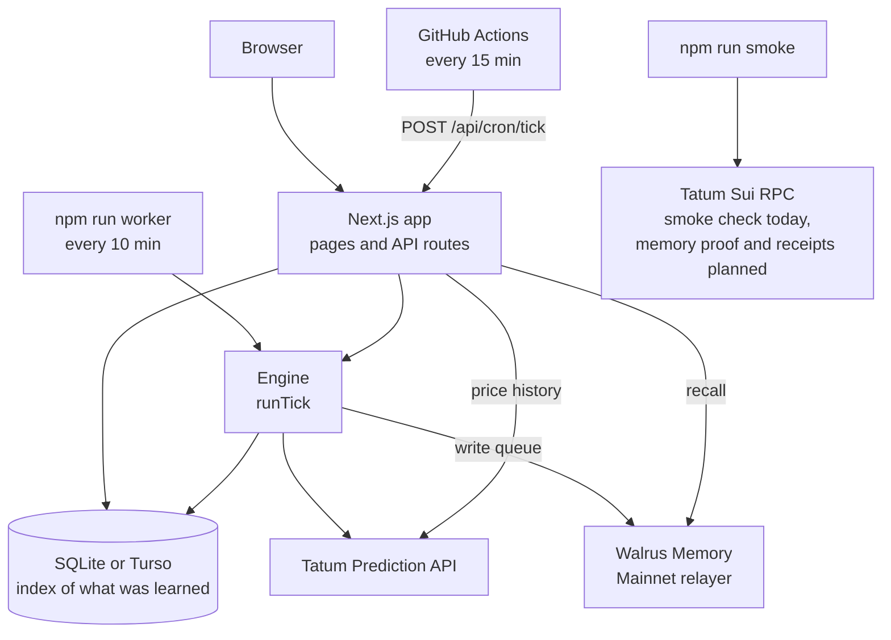
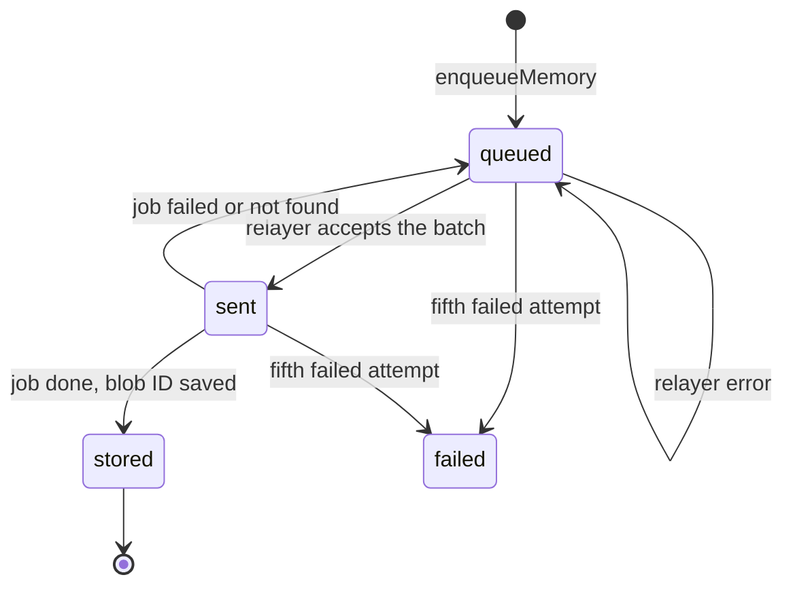

<!-- Before submitting: replace every <PLACEHOLDER>, then update "Project status" and "Hackathon requirements". -->

# Credence

**Polymarket shows you what the crowd thinks. Credence shows you what the traders who are usually right think, and it never forgets who they are.**

Credence is a read-only companion for prediction markets. It scores every Polymarket trader on skill rather than profit, keeps what it learns in Walrus Memory on Mainnet, and uses that record to publish a **Sharp Line**: the crowd price pulled toward where credible money sits. The Sharp Line appears next to the Polymarket and Kalshi prices. You can log your own picks before a market closes and be scored the same way the traders are.

Built for **Total Recall: the Tatum × Walrus Memory Hackathon**, track *Markets & Sports Prediction*.

| | |
|---|---|
| Live demo | `<DEMO_URL>` |
| Demo video | `<VIDEO_URL>` |
| Blog post | `<BLOG_URL>` |

## Project status


| Area | State |
|---|---|
| Tatum client, memory queue, scoring, voices, Sharp Lines, Kalshi pairing, resolutions, checkpoints, picks, engine tick | Built, and covered by 192 tests, mostly using fake Tatum and Walrus clients |
| Radar and Market pages; picks, recall and cron routes | Built. Checked over HTTP with real markets, but not yet reviewed in a browser |
| Tatum response schemas | Checked against real responses for market lists, single markets and price history. Positions, wallet history and top traders are unchecked, because those endpoints currently return 500 |
| Live run | Market sync works, with 110 open markets found. Holder snapshots, credibility and Sharp Lines are blocked by Tatum's wallet endpoints, so no memories are on Mainnet yet |
| Voices, My picks and Memory pages | Not built. The navigation links to them currently return 404 |
| Restore from Walrus, Time Machine, Amnesia demo | Not built |
| Sui | `npm run smoke` reads the memory account on Mainnet through Tatum's GraphQL gateway. The memory proof and onchain receipts are not built |
| Sportsbook odds | Not built (stretch goal) |
| Deployment, public repo, blog post | Not done |

## What it learned

These numbers come from the live run.

| | |
|---|---|
| Memories stored on Walrus Mainnet | `<MEMORIES_STORED>` |
| Traders (voices) scored | `<VOICES_SCORED>` |
| Markets resolved and turned into lessons | `<LESSONS>` |
| Trust in sharp money (λ), sports | `<LAMBDA_SPORTS>` (started at 0.25) |
| Trust in sharp money (λ), politics | `<LAMBDA_POLITICS>` (started at 0.25) |
| Sharp Line Brier vs crowd Brier (lower is better) | `<BRIER_SHARP>` vs `<BRIER_CROWD>` |
| Memory account on Sui | `<MEMWAL_ACCOUNT_ID>` |

## Contents

- [The idea](#the-idea)
- [What you see](#what-you-see)
- [How it works](#how-it-works)
- [Scoring model](#scoring-model)
- [Memory on Walrus](#memory-on-walrus)
- [Tatum integration](#tatum-integration)
- [The engine tick](#the-engine-tick)
- [Data model](#data-model)
- [HTTP API](#http-api)
- [Repository layout](#repository-layout)
- [Run it locally](#run-it-locally)
- [Configuration](#configuration)
- [Commands](#commands)
- [Deploying](#deploying)
- [Testing](#testing)
- [Design decisions](#design-decisions)
- [Known limitations](#known-limitations)
- [Roadmap](#roadmap)
- [Hackathon requirements](#hackathon-requirements)
- [Stack](#stack)

## The idea

A market price tells you what the crowd believes on average. It doesn't tell you who is behind it, and a leaderboard doesn't help much: a large wallet can show a big profit through size and a few lucky bets.

Skill looks different. A trader who keeps buying outcomes at 40¢ that win more than 40% of the time is finding mispriced bets, whatever their bankroll. Credence measures exactly that, using each wallet's settled history.

Three properties follow from this:

- **No cold start.** The voices are onchain wallets with existing records, so Credence can judge them from day one.
- **Skill is measured against the price paid.** Winning at 95¢ earns little credit. Winning at 30¢ earns a lot.
- **It can be wrong, and it measures that.** How much Credence trusts sharp money is learned per category from resolved markets. If sharp money adds nothing in a category, that trust falls toward zero and the Sharp Line collapses back onto the crowd price.

Credence never trades, holds funds, or places bets. Using it needs no wallet.

## What you see

### Radar (`/`)

Open Polymarket markets, ranked by how far credible money or Kalshi disagrees with the crowd. Each row has a 0–100% track for the market's first outcome with up to three markers:

| Marker | Meaning |
|---|---|
| Amber tick | Crowd (Polymarket price) |
| Blue dot | Sharp Line |
| Magenta diamond | Kalshi price for the same event, on manually paired markets |

The distance between markers is the disagreement. Filters narrow the list to sports, politics, culture or crypto.

### Market (`/market/[id]`)

- The same track at full size, with the crowd, Sharp Line and Kalshi numbers and the gap between Sharp Line and crowd.
- **Who is behind the Sharp Line:** the 20 largest holders, each with their side, position size, remembered credibility and how much they count toward the line.
- **Price history:** the crowd price over the last 7 days, with each computed Sharp Line marked on it.
- **Similar markets Credence remembers:** past lessons recalled from Walrus Memory by semantic search, each linked to its Walrus blob.
- **Log your pick:** choose an outcome, set your confidence and optionally say why. Picks are accepted only before the market closes, so every call is on the record in advance.

## How it works

Credence runs a five-step loop:



And this is how the pieces connect:



### The life of one market

1. **Found.** `syncMarkets` picks it up among the newest active markets with at least $10,000 of volume closing within 3 days. It's assigned a category, and its price is recorded.
2. **Paired.** If it's listed in `data/venue-overrides.json`, `syncKalshi` fetches the matching Kalshi price.
3. **Watched.** `snapshots` records who holds each side, every 6 hours, while it's among the 20 highest-volume open markets closing within 72 hours.
4. **Judged.** `history` pulls the settled bets of each holder with a position of $500 or more. `rescore` turns those bets into credibility per category and writes a dossier memory when something notable changes.
5. **Priced.** `sharpLines` computes a Sharp Line for each new snapshot, using the holders' remembered credibility.
6. **Called.** Within 90 minutes of close, a final snapshot is taken and a call memory goes on the record, before the outcome is known.
7. **Resolved.** After close, `resolutions` asks Tatum for the outcome, waiting longer between each check. When it arrives, Credence settles picks, flags the holders for a history refresh, writes a lesson memory, refits λ for that category and writes a checkpoint.
8. **Applied.** The next market in that category uses the updated credibility and λ.

## Scoring model

All scoring is in pure functions under [`src/lib/scoring/`](src/lib/scoring/), with no database or network access. The example numbers below are illustrative and match the unit tests. They are not live results.

### Categories

`SPORTS`, `POLITICS`, `CRYPTO`, `CULTURE`, `MENTIONS`, `WEATHER`, `ECONOMICS`, `TECH`, `FINANCE`, `OTHER`, plus `OVERALL` for a wallet's whole record.

Wallet history rows have no category, so [`categorize`](src/lib/scoring/categorize.ts) tries these in order: the API category, a league prefix in the slug (`nba-`, `epl-`), then keyword and team-name matching on the title.

### Voice credibility

[`credibility.ts`](src/lib/scoring/credibility.ts) scores each settled bet, where `p` is the average price paid and `y` is the resolution price of the held outcome (1 = won, 0 = lost):

```
edge per bet       e = y − p
variance per bet   v = p(1 − p)

z                  = Σe / √(Σv + 0.25·K)      K = 10
credibility        = 50 + 50·tanh(z / 3)      range 0–100, 50 means no evidence
shrunk mean edge   = Σe / (n + K)
```

Bets are excluded when `p` is at or below 0.005 or at or above 0.995, when under $5 was staked, or when they settled after the `asOf` time. Excluding later settlements means credibility can be recomputed for any past date.

`K` acts as ten pseudo-bets of evidence, which keeps lucky small samples near neutral:

| Record | z | Credibility |
|---|---|---|
| 3 wins, all bought at 50¢ | 0.83 | 63.5 |
| 100 bets bought at 40¢, 50 of them won | 1.94 | 78.5 |
| 40 losses, all bought at 60¢ | −6.90 | 1.0 |

Winning half the time at 40¢ over 100 bets scores higher than a perfect record over 3. Profit and volume are stored and displayed but never affect credibility, and a test pins this.

### Sharp Line

[`sharpLine.ts`](src/lib/scoring/sharpLine.ts) works on two-outcome markets. For each holder of a market, with position value `V` and credibility `C` in the market's category:

```
weight       w = ((C − 50) / 50)² · ln(1 + V)     when C > 55, otherwise 0
consensus    S = Σw on outcome A / Σw
Sharp Line   L = clamp(q + λ·(S − q), 0.01, 0.99)   q = crowd price of outcome A
```

- Skill counts quadratically and money logarithmically, so a large position can't buy influence.
- If `Σw` is below 1.0 there is no line, and the app says there isn't enough credible money.
- A category score counts only with 5 or more bets behind it. Otherwise Credence falls back to the wallet's overall score under the same rule, and then to unknown, which carries no weight.
- The five largest contributors are saved with each line, so it can be explained later.

**Example.** The crowd has outcome A at 50%. One wallet with credibility 80 holds $1,000 of A (weight 2.49). Another with credibility 60 holds $1,000 of B (weight 0.28). Credible consensus is `S = 0.9`, and with `λ = 0.25` the Sharp Line is `0.5 + 0.25 × 0.4 = 60%`.

### Learning how much to trust sharp money

[`learning.ts`](src/lib/scoring/learning.ts) fits λ separately for each category. Each resolved market with a pre-close Sharp Line gives one observation of crowd price `q`, consensus `S` and outcome `y`:

```
λ = clamp( (Σ(S − q)(y − q) + κ·λ₀) / (Σ(S − q)² + κ), 0, 0.6 )     λ₀ = 0.25, κ = 0.5
```

This is least squares shrunk toward a prior. Starting from the prior, one market with `q = 0.5` where sharp money was fully on the winner moves λ from 0.25 to 0.5. The cap at 0.6 means sharp money never fully overrides the crowd.

**Measuring whether it helps.** [`learningCurve`](src/lib/scoring/learning.ts) scores markets in the order they resolved. Each market's line uses a λ fitted only on earlier markets in its category, so the comparison never sees the future. It reports cumulative Brier score for the Sharp Line and for the crowd.

### Pairing with Kalshi

[`matching.ts`](src/lib/scoring/matching.ts) pairs a Polymarket market with a Kalshi market when their questions have a Jaccard similarity of at least 0.55 after removing stopwords, and their close times are within 3 days. Kalshi asks yes/no per side, so if its question names Polymarket's second outcome first, the quote is flipped to `1 − yes`. Entries in [`data/venue-overrides.json`](data/venue-overrides.json) replace automatic matches:

```json
[{ "polyId": "0x…", "kalshiId": "KX…", "flip": false }]
```

The engine doesn't list Kalshi markets today, so only pairs in this file get a Kalshi price. On the live API, Kalshi's list ignored `sort`, was about 70% multi-leg parlays, and matched none of 110 Polymarket markets. `KALSHI_PAGES` in [`tick.ts`](src/engine/tick.ts) turns listing back on.

### Picks

A pick needs a confidence between 50% and 99%, on an open market. Credence records the market price of that outcome at that moment, plus the Sharp Line and Kalshi price when available.

```
edge          = y − price at pick
Brier (you)   = (confidence − y)²
Brier (market)= (price at pick − y)²
```

[`picks.ts`](src/engine/picks.ts) also computes a user credibility with the same formula as wallets, and a bias report: overconfidence (mean confidence minus hit rate), favorite lean (mean price of your picks) and edge per category. These are computed and tested, but no page displays them yet.

### Constants

| Constant | Value | Where |
|---|---|---|
| Prior strength `K` | 10 pseudo-bets | `credibility.ts` |
| Credibility scale | `tanh(z / 3)` | `credibility.ts` |
| Minimum credibility to count | above 55 | `sharpLine.ts` |
| Minimum total weight for a line | 1.0 | `sharpLine.ts` |
| λ prior, shrinkage, cap | 0.25, 0.5, 0.6 | `learning.ts` |
| Pairing similarity, close gap | 0.55, 3 days | `matching.ts` |

## Memory on Walrus

Credence writes to Walrus Memory on Mainnet through `@mysten-incubation/memwal`, using the relayer at `https://relayer.memory.walrus.xyz`.

### What gets remembered

| Namespace | Kind | Written when |
|---|---|---|
| `credence-voices` | `dossier` | A wallet's first score in a category covers 20+ bets and is 65 or higher, or 35 or lower; or a later rescore moves it by 5 or more |
| `credence-calls` | `call` | A final snapshot gets its Sharp Line, within 90 minutes of close |
| `credence-lessons` | `lesson` | A market with a pre-close Sharp Line resolves |
| `credence-checkpoints` | `checkpoint` | A tick writes at least one lesson |
| `credence-user-<handle>` | `pick`, `scorecard` | A user logs a pick, or that pick settles |

Dossiers are written per category and never for `OVERALL`, which avoids near-duplicate memories for each wallet.

The text follows these templates (values here are illustrative):

```text
Wallet 0xab12…9f3c (JaneDoe) is sharp on SPORTS: credibility 81 over 142 resolved bets, average edge +6.2 pts.

Final call — "Lakers vs. Celtics": crowd 41% on Lakers, Sharp Line 50%. Credible money leans Lakers (78% of credible weight, λ 0.25).

"Lakers vs. Celtics" resolved Lakers. The Sharp Line (50%) beat the crowd (41%) on Lakers. Credible voices right: 0xab12…9f3c; wrong: 0x77cd…01aa.

Credence trust model — Checkpoint #37 (resolutions): λ SPORTS 0.31, POLITICS 0.08; 100 credible voices; learned from 182 resolved markets; previous checkpoint blob <blob id>.

@ravi picked Lakers on "Lakers vs. Celtics" at 70% confidence when the market said 41% (Sharp Line 50%, Kalshi 45%). Reason: healthy defense

Scorecard for @ravi: picked Lakers on "Lakers vs. Celtics" at 70% (market 41%) — WON. Edge +59 pts vs the market; Brier 0.090 vs market 0.348.
```

### One blob, two readers

Each memory is a plain sentence followed by a machine-readable payload ([`format.ts`](src/lib/memory/format.ts)):

```text
<sentence, which semantic recall embeds>
§credence/v1 {"kind":"lesson","data":{…}}
```

So the same blob serves both a search and a program that needs exact fields. Memories are capped at 12,000 characters.

### The write queue

Nothing calls the relayer directly. Every memory first goes into the `memories` table, and [`flushMemoryQueue`](src/lib/memory/writer.ts) moves the queue forward once per tick:



- **Rate budget.** The relayer allows 500 points per hour and 60 per minute per account, and each remember costs 5. Credence stays under that with 400 and 50, which leaves room for recalls. That's at most 80 memories per hour and 10 per minute. With one flush per 10-minute worker tick, expect about 60 per hour.
- **Bulk writes.** Queued memories go out oldest first in one `rememberBulkAsync` call, with an idempotency key derived from the row IDs. Each row can target its own namespace.
- **Failure handling.** Rows are never deleted. Relayer errors raise a row's attempt count and record the error. After 5 attempts it's marked `failed` and stays in the table for inspection.
- **No memory configured.** Without Walrus keys the tick skips the flush, and memories wait in the queue until keys are added.

### The checkpoint chain

Each checkpoint stores the whole trust model in one memory: λ per category, resolution statistics, and up to 100 of the strongest voices with 20+ bets, as `[address, group, credibility, n]`. It also carries `prevBlobId`, the blob of the latest checkpoint already stored on Walrus, which makes the checkpoints an append-only audit trail.

### How memory reaches the product

| Reads from | Used for | State |
|---|---|---|
| Walrus `recall` | "Similar markets Credence remembers" on the Market page | Built |
| Local `voice_scores` and `lambdas` tables | Sharp Lines and holder credibility, which need fast reads | Built |
| Walrus latest checkpoint | Rebuilding the trust model after a wipe (`restoreFromWalrus`, the Amnesia demo) | Planned |
| Checkpoint history | Time Machine: what Credence believed on an earlier date | Planned |

Every memory row also stores an `effect`, the product change it caused, for example λ moving from 0.25 to 0.31 in a category. The planned Memory page shows these beside each blob.

## Tatum integration

### Prediction API

Base URL `https://api.tatum.io/v4/data/prediction`, authenticated with `x-api-key`. The typed client is in [`src/lib/tatum/`](src/lib/tatum/).

| Client method | Endpoint | Credits | Used for |
|---|---|---|---|
| `listMarkets` | `GET /markets` | 100 | Market discovery on Polymarket |
| `getMarket` | `GET /markets/{id}` | 100 | Checking whether a closed market has resolved; reading paired Kalshi markets |
| `getMarketPositions` | `GET /markets/{id}/positions` | 100 | Who holds each side |
| `getWalletHistory` | `GET /wallets/{address}/history` | 100 | A wallet's settled bets |
| `getTopTraders` | `GET /top-traders` | 200 | Wallet names and badges (`npm run election:calls`) |
| `getPriceHistory` | `GET /markets/{id}/history` | 200 | The Market page chart, at most once per market per hour |

Positions, wallet history and top traders exist only for Polymarket, so Kalshi contributes prices only. If price history fails or returns no candles, the chart uses prices already stored.

### Client behavior

[`TatumHttp`](src/lib/tatum/http.ts) handles the following:

- **Rate limit.** Request starts are spaced to 2.5 per second by default, including across concurrent callers. Tatum's gateway answers 429 above 3 per second on the free plan.
- **Retries.** 429s, 5xx responses and network errors get up to 3 attempts with jittered backoff. Other errors fail immediately. Each attempt times out after 20 seconds.
- **Credit budget.** Before each call, it checks the credits used since UTC midnight against `TATUM_DAILY_CREDIT_CAP`, and throws `CreditCapError` rather than overspending.
- **Usage log.** Every response is recorded in `api_usage`, with IDs collapsed in the path (`/markets/:id/positions`) so usage groups by endpoint.
- **Validation.** Zod schemas check every response. They accept nulls, tolerate extra fields, and convert numeric strings to numbers.

### Credit budget

`TATUM_DAILY_CREDIT_CAP` is split in two, so routine work can't crowd out what matters most:

- **Optional work** shares 70% of the cap, released evenly through the UTC day. With a cap of 60,000, 21,000 has been released by noon. When it runs short, stages report `waiting for credits` or do less, and they resume as more is released.
- **Essential work** can use the whole cap: resolution checks and final snapshots. All Tatum calls stop at 100%.

Maximum credits at full page sizes:

| Work | Budget | Cadence | Per run | Per day |
|---|---|---|---|---|
| `syncMarkets` | Optional | 1 h | 200 | 4,800 |
| Routine snapshots | Optional | 6 h | 2,000 | 8,000 |
| Paired Kalshi markets | Optional | 6 h | 100 per pair | 400 per pair |
| **Scheduled total** | | | | **12,800**, plus pairs |
| `history` | Optional | Every tick | 3,000 | What's left of the optional share |
| Market page chart | Optional | Once per market per hour | 200 | Varies |
| Final snapshots | Essential | Every tick | 2,000 | Varies |
| `resolutions` | Essential | Every tick, with backoff per market | 2,000 | Varies |

### Sui RPC

[`createTatumSuiClient`](src/lib/sui/client.ts) connects to `https://sui-mainnet.gateway.tatum.io/graphql` with the same API key. Tatum's documentation shows JSON-RPC on this host, but the documented request returns 404 and the gateway's own `/_methods` listing offers only GraphQL.

Today only `npm run smoke` uses this client: it reads the latest checkpoint and the Walrus Memory account object. The memory proof and onchain receipts are on the [roadmap](#roadmap).

## The engine tick

[`runTick`](src/engine/tick.ts) is one pass of the engine, shared by the local worker and the cron route. Stage cadence is stored in the `kv` table, so ticks can be frequent and cheap.

| Stage | Runs | What it does |
|---|---|---|
| `syncMarkets` | Every hour | Up to 2 pages of 100 of the newest active Polymarket markets closing within 3 days, with $10,000+ of volume. Markets past their close time are dropped |
| `syncKalshi` | Every 6 h | Fetches the Kalshi markets named in `data/venue-overrides.json`. With no pairs it makes no calls |
| `snapshots` | Routine every 6 h; final every tick | Routine: holders of the top 20 open markets. Final: up to 20 markets per tick, biggest first, closing within 90 minutes with no final snapshot |
| `history` | Every tick | Settled bets (up to 2 pages of 50) for up to 15 wallets, as the credit budget allows, holding $500+ in the last 48 hours, whose history is missing, flagged or over 24 hours old |
| `rescore` | When `history` changed something | Recomputes credibility and writes dossiers |
| `sharpLines` | Every tick | A line for each snapshot from the last 48 hours that lacks one. Final snapshots also write a call |
| `resolutions` | Every tick | Up to 20 closed markets with a Sharp Line or an open pick: settle picks, write lessons, refit λ, checkpoint. A market still unresolved waits 30 minutes, doubling up to 24 hours |
| `flushMemory` | Every tick | Settles finished jobs and sends queued memories |

**Failure isolation.** Each stage runs in its own try/catch. A stage that throws is reported and the rest still run, and a cadence stage that failed retries on the next tick. A missing key makes the stage report `skipped`. Snapshots stop after 3 failures in a row, because that means an outage rather than a bad market. A routine run where every snapshot failed doesn't count as finished, so the engine resumes as soon as Tatum recovers.

A keyless tick looks like this:

```text
✓ syncMarkets       0ms  skipped: tatum not configured
✓ syncKalshi        0ms  skipped: tatum not configured
✓ snapshots         0ms  skipped: tatum not configured
✓ history           0ms  skipped: tatum not configured
✓ rescore           0ms  nothing to do
✓ sharpLines        4ms  {"lines":0,"calls":0}
✓ resolutions       0ms  skipped: tatum not configured
✓ flushMemory       0ms  skipped: memory not configured
```

Times are stored as UTC epoch milliseconds, and prices and probabilities as numbers from 0 to 1.

## Data model

There are 16 tables, defined in [`schema.ts`](src/lib/db/schema.ts), using Drizzle ORM on libSQL.

| Table | Holds |
|---|---|
| `markets` | Polymarket and Kalshi markets with outcomes, category, close time and resolution |
| `market_prices` | Price points, from market listings and from price history |
| `venue_pairs` | Polymarket to Kalshi pairings, with score, flip and method (`auto` or `manual`) |
| `wallets` | Wallet names, badges and history freshness |
| `closed_positions` | Each wallet's settled bets, with a derived category |
| `snapshots` | One row per holder snapshot of a market: `routine`, `final` or `election` |
| `holder_snapshots` | The holders in each snapshot |
| `voice_scores` | Credibility per wallet, per category, per scoring time |
| `sharp_lines` | Each computed line, with crowd price, consensus, λ and top contributors |
| `lambdas` | λ per category over time, with Brier scores |
| `picks` | User picks, the prices at pick time and their settlement |
| `memories` | The write queue, and an index of everything sent to Walrus with blob IDs and effects |
| `checkpoints` | Local copy of each trust-model checkpoint |
| `receipts` | Reserved for onchain receipts |
| `api_usage` | One row per Tatum response: endpoint, credits, status, time |
| `kv` | Stage cadence timestamps |

The local database is designed as a cache and index, so it can be rebuilt. Today, only the distilled knowledge in `memories` reaches Walrus. Raw inputs such as positions and prices stay local.

## HTTP API

| Route | Purpose | Responses |
|---|---|---|
| `POST /api/picks` | Log a pick. Body: `{ handle, marketId, outcomeIndex, confidence, reason? }` | `201 { pick }`, and sets the `credence_handle` cookie. `400 { code }` otherwise |
| `GET /api/memory/recall?ns=&q=` | Semantic recall. `ns` is `lessons`, `calls` or `voices` | `200 { configured, hits }`. `400` if a parameter is missing. `502` if the relayer fails |
| `POST /api/cron/tick` | Run one engine tick. Needs `Authorization: Bearer <CRON_SECRET>` | `200` with the tick report. `401` for a wrong secret. `503` if `CRON_SECRET` isn't set |

Pick error codes are `BAD_REQUEST`, `BAD_HANDLE`, `BAD_CONFIDENCE`, `BAD_OUTCOME`, `MARKET_NOT_FOUND`, `MARKET_CLOSED` and `NO_PRICE`. A handle is 3–20 letters, numbers or underscores, stored in lowercase. Reasons are cut to 280 characters.

## Repository layout

```text
src/
  app/               Pages (Radar, Market) and API routes
  components/        ProbabilityTrack, MarketRow, SharpBreakdown, PriceChart, PickForm, DejaVu, Nav, KeyBanner
  engine/            Everything that does work over time
    ctx.ts             Dependency injection: db, tatum, memory, clock, logger
    tick.ts            Stage orchestration and cadence
    markets.ts         Market sync and election market search
    holders.ts         Holder snapshots
    voices.ts          Leaderboard seeding, history refresh, rescoring, dossiers
    sharp.ts           Sharp Line computation and storage
    calls.ts           Pre-close call memories
    venues.ts          Kalshi sync, pairing and quotes
    resolve.ts         Resolutions, lessons, λ refit
    observations.ts    Winner detection and pre-close line lookup
    checkpoint.ts      Trust-model checkpoints
    picks.ts           Pick creation, settlement, bias report
    priceHistory.ts    On-demand chart data
  lib/
    scoring/           Pure math: categorize, credibility, sharpLine, learning, matching
    memory/            Walrus Memory: codec, namespaces, rate budget, write queue, reader
    tatum/             Prediction API: HTTP client, schemas, typed methods
    sui/               Tatum Sui RPC client
    db/                Schema, client, migrations
    queries.ts         Read models for pages
    env.ts             Environment parsing and feature flags
    cron.ts            Cron route authorization
scripts/             worker, smoke, capture-fixtures, snapshot-election, election-calls
tests/               Vitest suites, fakes and fixtures, mirroring src/
drizzle/             SQL migrations
data/                Local database (ignored by git) and venue-overrides.json
docs/superpowers/    Design spec and implementation plan
.github/workflows/   Scheduled engine tick
```

## Run it locally

You need **Node 22.12 or later** (`vitest` and `@mysten/sui` both require it) and npm.

### Browse without keys

```bash
git clone <REPO_URL>
cd credence
npm install
npm run dev
```

Open http://localhost:3000. The database is created and migrated automatically at `data/credence.db`. A banner says which keys are missing, and the Radar shows an empty state until there's data.

### Run it live

1. **Get keys.** You need a Tatum mainnet API key from [dashboard.tatum.io](https://dashboard.tatum.io), and a Walrus Memory account ID and private key from [memory.walrus.xyz](https://memory.walrus.xyz) (create an agent).

2. **Add them to `.env.local`.** This file is ignored by git.

   ```bash
   cp .env.example .env.local
   ```

3. **Check every dependency.** This prints one ✓ or ✗ line each for the Tatum Prediction API, Walrus Memory and Tatum Sui RPC, and exits with an error if any fail. It costs 100 Tatum credits.

   ```bash
   npm run smoke
   ```

4. **Start the engine and the app**, in two terminals. Markets appear after the first tick. Credibility, lines and calls build up over later ticks, and lessons arrive as markets resolve.

   ```bash
   npm run worker
   npm run dev
   ```

The `npm run` engine scripts load `.env.local` and stop with `node: .env.local: not found` if it doesn't exist. A copy of `.env.example` with empty values is enough to run them without keys.

## Configuration

| Variable | Needed for | Default |
|---|---|---|
| `TATUM_API_KEY` | Live markets, Sui RPC | None |
| `TATUM_DAILY_CREDIT_CAP` | Daily credit limit. Optional work stops at 70% of it and all Tatum calls stop at 100%. Set it from your plan's allowance | `60000` |
| `MEMWAL_ACCOUNT_ID`, `MEMWAL_PRIVATE_KEY` | Writing to and recalling from Walrus Memory | None |
| `MEMWAL_SERVER_URL` | Relayer address | `https://relayer.memory.walrus.xyz` |
| `DATABASE_URL` | Local SQLite file, or `libsql://…` for Turso | `file:./data/credence.db` |
| `DATABASE_AUTH_TOKEN` | Turso only | None |
| `CRON_SECRET` | `POST /api/cron/tick` | None (route returns 503) |
| `WALLET_DATA_SOURCE` | Where wallet data comes from: `auto` (Tatum, switching to Polymarket's public v2 API for 30 minutes after a Tatum outage), `tatum` or `polymarket` | `auto` |

`SUI_RECEIPTS_PRIVATE_KEY`, `SUI_RECEIPTS_PACKAGE_ID`, `ODDS_API_KEY` and `AMNESIA_ENABLED` are parsed, but no feature uses them yet.

## Commands

| Command | What it does |
|---|---|
| `npm run dev` | Development server |
| `npm run build`, `npm start` | Production build and server |
| `npm test` | Runs the test suite |
| `npm run lint` | ESLint |
| `npm run worker` | Engine loop, one tick every 10 minutes. Add `-- --once` for one tick |
| `npm run smoke` | Checks every live dependency |
| `npm run capture:fixtures` | Saves one real response per Tatum endpoint to `tests/fixtures/tatum/real-*.json` |
| `npm run snapshot:election` | Records holders of the 40 largest open 2026 US election markets |
| `npm run election:calls` | Scores those holders, writes election calls to Walrus Memory and waits for the queue to drain. `-- --no-wait` skips the wait |
| `npm run db:generate` | Generates a migration after a schema change |
| `npm run db:push` | Applies the schema to the database in `DATABASE_URL` |

- The election scripts were built to put calls on record before polls opened on 2026-11-03. That window passed before keys were configured, so no pre-election calls exist. Calls from running them now would be made after voting, and must not be presented as predictions.
- Engine scripts run under `tsx --conditions=react-server`, because that's what lets modules marked `server-only` load outside Next.js. The npm scripts already pass this flag.

## Deploying

This is the intended path, and it hasn't been exercised yet.

1. **Create a [Turso](https://turso.tech) database and apply the schema.** The cron route doesn't run migrations, and `db:push` doesn't read `.env.local`, so pass the values directly:

   ```bash
   DATABASE_URL=libsql://… DATABASE_AUTH_TOKEN=… npm run db:push
   ```

2. **Deploy to Vercel**, with the variables from [Configuration](#configuration). A local SQLite file won't persist on serverless hosting, so `DATABASE_URL` must point at Turso.

3. **Schedule the engine.** [`tick.yml`](.github/workflows/tick.yml) calls `POST /api/cron/tick` every 15 minutes. Add `APP_URL` and `CRON_SECRET` as GitHub Actions secrets. GitHub runs scheduled workflows only from the default branch. The route allows up to 300 seconds per run.

Alternatively, keep `npm run worker` running on any machine pointed at the same database.

## Testing

```bash
npm test                              # 192 tests in 27 files
npx next typegen && npx tsc --noEmit  # type check; route types must be generated first
```

**How it's tested:**

- Scoring is pure functions with exact expected values.
- Engine tests run against a real in-memory SQLite database with the real migrations applied ([`tests/helpers/db.ts`](tests/helpers/db.ts)).
- Engine dependencies are injected through [`EngineCtx`](src/engine/ctx.ts), so tests pass in a fixed clock and fakes. [`fakeTatum`](tests/helpers/fakeTatum.ts) throws on any endpoint a test didn't stub, so an unexpected call fails loudly. [`fakeMemory`](tests/helpers/fakeMemory.ts) lets a test decide when each relayer job finishes or fails.

**Failure cases the tests pin:**

| Situation | Expected behavior |
|---|---|
| Tatum returns 429, 5xx or a network error | Retries, then a typed error. Other tick stages still run |
| Tatum fails for one market during resolutions | The other markets still resolve |
| Credit cap reached | Throws before making the request, and resolution checks stop for that tick |
| Optional credits spent | Market sync, routine snapshots and wallet history wait, while resolutions and final snapshots continue |
| Market stays unresolved | Checks back off from 30 minutes to 24 hours, and newer markets still get checked |
| Pick on a market with no Sharp Line | Settles when the market resolves, with no lesson or checkpoint |
| Every routine snapshot fails | Stops after 3 failures, then retries on the next tick |
| Relayer fails or rate-limits | Rows stay queued with attempts counted, and become `failed` after 5 |
| Rate budget used up | Nothing is sent, and rows stay queued |
| Market has three outcomes or no price | No Sharp Line and no crash |
| Pick at or after close, or on a resolved market | Rejected with `MARKET_CLOSED` |
| Keys missing | Stages report `skipped`, and memories stay queued |

**Not covered yet:** actual writes to Walrus Memory, page review in a browser, and real responses from the positions, wallet history and top-traders endpoints. Those fixtures are hand-written from Tatum's documentation, while the `real-*.json` fixtures were captured from the live API.

## Design decisions

| Decision | Why | Trade-off |
|---|---|---|
| Score skill against the price paid, not profit | Profit rewards size and luck | Needs settled history, so new wallets stay near neutral |
| Shrink toward neutral with `K = 10` | Small lucky samples shouldn't look sharp | Real skill takes more bets to show |
| Skill counts quadratically, money logarithmically | A large position shouldn't buy influence | Very large informed bets are underweighted |
| Only credibility above 55 counts | Near-neutral wallets add noise | Reliable fades carry no opposite signal |
| Learn λ per category, capped at 0.6 | Sharp money may help in sports and not in politics | Needs resolved markets per category before it moves |
| Evaluate with earlier data only | The Brier comparison must not see the future | None |
| Queue every memory in the database first | Relayer limits and outages must not lose knowledge | Memories reach Walrus minutes after they're written |
| Release optional credits evenly and reserve 30% of the cap | Resolutions must keep working, and a burst shouldn't spend a whole day's budget | Wallet history builds up more slowly |
| Plain sentence plus JSON in one memory | Semantic search needs prose, and restoring needs fields | Slightly larger memories |
| Use the local database for hot reads | A Sharp Line reads credibility for each holder, which recall can't serve at that speed | Two copies of the trust model to keep consistent |
| Handles instead of accounts | No sign-up or wallet needed | Handles aren't authenticated |
| Two-outcome markets only | Polymarket multi-outcome events are already sets of binary markets | Other multi-outcome markets get no Sharp Line |

## Known limitations

- **Tatum's wallet endpoints currently fail.** Positions, wallet history and top traders return `500`. Polymarket retired its Data API v1 (it now answers `410`), which those endpoints appear to depend on. Credence falls back to Polymarket's public v2 API for wallet data (see `WALLET_DATA_SOURCE`). Polymarket is blocked in some countries, including India, so the fallback only works from servers outside them. `npm run check:polymarket` tests it.
- **Market discovery relies on one query.** Tatum's `category` and `tag` filters returned nothing on the live API, even for its documented example, and many markets stay `active` after their close time. Credence uses newest-first with a $10,000 volume floor, so low-volume markets and those closing beyond 3 days aren't tracked.
- **Kalshi prices need manual pairs.** See [Pairing with Kalshi](#pairing-with-kalshi).
- **Close times are coarse.** Many markets close at midnight UTC, which can be before the event itself. Picks and final calls therefore happen earlier than necessary, never later.
- **Charts may use stored prices only.** Tatum's price history returned no candles for a high-volume market in the captured response. The chart then uses prices recorded by market sync.
- **Failed memories aren't retried automatically.** After 5 failed attempts a row stays `failed`. At worker cadence, a relayer outage of about 50 minutes is enough to fail the rows at the front of the queue.
- **Query counts suit a local file.** The Radar runs several queries per market for up to 300 markets, and Sharp Lines run queries per holder. This is fine on local SQLite, but expect it to be slow over a remote Turso connection.
- **Public routes have no rate limits.** Anyone can log a pick under any handle, and each recall uses relayer budget.
- **Lint isn't clean.** `npm run lint` reports 3 `react-hooks/purity` errors for `Date.now()` in server components, plus 11 unused-variable warnings. The build and type check pass.

## Roadmap

- **Voices** (`/voices`, `/voices/[address]`): a skill leaderboard per category, a chart of profit against credibility, and a dossier for each wallet.
- **My picks** (`/me`): open and settled picks, calibration, the bias report, and warnings at pick time based on your record.
- **Memory** (`/brain`): the memory feed with blob links and effects, a Sui proof of the memory account, and the learning curve.
- **Amnesia:** wipe the learned tables, restore the trust model from the latest Walrus checkpoint, and show the numbers coming back.
- **Time Machine:** a slider over checkpoints showing what Credence believed on an earlier date, with Sharp Lines recomputed from that memory.
- **Sui receipts:** a Move package that records picks and calls onchain, with a shareable receipt page, executed through Tatum RPC.
- **Demo database:** a committed `data/demo.db`, so reviewers can browse real data without keys.
- **Sportsbook odds** (stretch): a de-vigged consensus line from The Odds API.

## Hackathon requirements

| Requirement | State |
|---|---|
| Walrus Memory writing on Mainnet | Code targets the Mainnet relayer. No writes yet |
| At least 10 memories on Mainnet | 0 so far |
| Tatum RPC used for onchain data | `npm run smoke` reads the memory account on Mainnet through Tatum's Sui GraphQL gateway. The app doesn't use it yet |
| Public repo and working demo | Not yet published or deployed |
| Published blog post | Not written |
| Form fields: Tatum account ID, `MEMWAL_AGENT_ID` | Not submitted |

Submissions close 2026-11-10 at 17:00 UTC.

## Stack

| | |
|---|---|
| App | Next.js 16 with Cache Components, React 19, TypeScript, Tailwind CSS 4 |
| Data | Drizzle ORM, libSQL (SQLite locally, Turso in production) |
| Validation | Zod |
| Memory | `@mysten-incubation/memwal` |
| Chain | `@mysten/sui`, through Tatum's RPC gateway |
| Tests | Vitest |
| Scripts | tsx |
